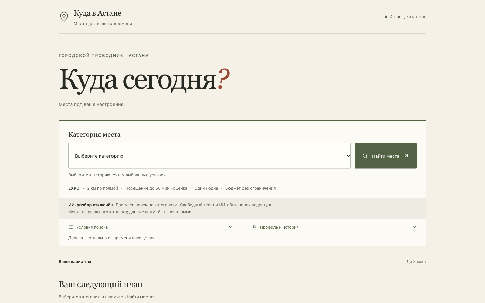
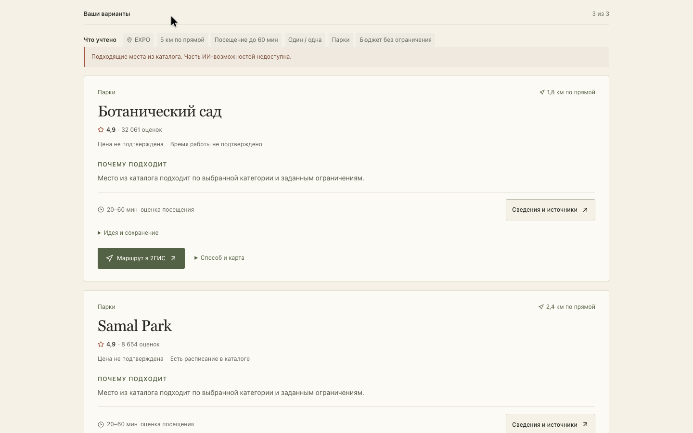

# Куда в Астане

Городской гид: выберите категорию, проверьте условия и откройте маршрут.

[**Открыть демо →**](https://aituhack-city-guide.vercel.app) · [Новое UI-демо — MP4](output/submission/aituhack-redesign-offline.mp4) · [Презентация проекта](output/submission/aituhack-live-demo.pptx)



> **Сейчас ИИ отключён.** Один реальный запрос при записи демо завершился без подтверждённой стоимости, поэтому существующий guard остановил все платные вызовы. Повтора не было. [Запись реальной неудавшейся попытки — MP4, 49,52 с](output/submission/aituhack-redesign-live-attempt.mp4). Категории, фильтры, источники и маршруты доступны без ИИ.

## Как пользоваться

1. Выберите **«Парки»** в поле **«Категория места»**.
2. В **«Условиях поиска»** задайте **EXPO → 5 км → 60 минут**, бюджет оставьте пустым.
3. Нажмите **«Найти места»**, откройте **«Сведения и источники»** или маршрут.

Свободный текст сейчас недоступен; форма сразу предлагает работающий поиск по категории.

Пустой бюджет — без денежного лимита. **0 ₸** требует подтверждённо бесплатного посещения: при неизвестной цене место исключается.

## Что работает

- Поиск по категориям и строгим ограничениям без платных вызовов.
- **0–3 реальных места** после строгих фильтров. Неизвестные свойства не подменяются фактами.
- Краткое резюме условий; дополнительные фильтры, демо-профили и история — по раскрытию.
- Источники и отзывы как мнения; идеи занятий отделены от подтверждённых сведений.
- Маршруты в **2ГИС / Google Maps**, пешком или на машине. Геолокация — только по нажатию.
- Адаптивный интерфейс от **360 px**, клавиатурный фокус и доступные подписи.



<details>
<summary>Мобильный экран: выбор категории, без ИИ</summary>


</details>

## Новое видео

[**Смотреть новое UI-демо — 81,52 с**](output/submission/aituhack-redesign-offline.mp4). Настоящий браузерный сценарий текущего режима без ИИ: категории, реальные места, источники и маршрут. Ответы получены от работающего API каталога, без подмен. 2ГИС запросила CAPTCHA; в ролике также открыт маршрут Google Maps из той же карточки. H.264, yuv420p, faststart, без звука.

Ролик записан до исправления формы21октября; сейчас категория доступна сразу на главном экране.

Успешное новое ИИ-демо **не записано**: единственная live-попытка дала уточнение без мест и неизвестную стоимость. Она сохранена отдельно по ссылке выше.

[Предыдущий ролик — stub, 1:50](output/submission/aituhack-demo.mp4) сохранён отдельно. Он не представляет текущую версию.

## Данные и ИИ

**298 мест · 7 категорий · 591 короткая выдержка с источниками.** Импорт из сохранённого снимка 2ГИС/Apify от 19 октября 2026. Каталог и индекс не пересобирались ради редизайна.

Live-конвейер сохранён в коде: Mistral Small 3.2 / DeepInfra через серверный OpenRouter разбирает запрос и объясняет выбор. Сейчас он отключён из-за новой неизвестной стоимости; автоматического снятия блокировки нет. Embeddings — `openai/text-embedding-3-small`, индекс **298 × 1536**. Названия, рейтинги, координаты, часы и ссылки берутся из каталога; сервер проверяет ID, источники и ограничения.

[Контракт API](docs/data-contract.md) · [Происхождение данных](docs/collection-import.md) · [RAG и метрики](docs/indexing.md) · [Аудит редизайна](docs/ui-redesign-audit.md)

## Запуск и проверки

Node.js **24.21.0**, pnpm **11.0.8**.

```sh
pnpm install --frozen-lockfile
APP_AI_MODE=stub OPENROUTER_PAID_ENABLED=false LIVE_EVAL_ENABLED=false pnpm dev
```

Без платных вызовов доступны категории и пять демо-фраз. Для live нужен серверный OpenRouter и существующий учёт расходов; [правила бюджета](docs/budget.md). Ключи, `.env`, ledger, raw/normalized и пользовательские данные не публикуются.

```sh
pnpm lint
pnpm typecheck
pnpm test
pnpm build
pnpm check:build-artifacts
pnpm test:e2e
pnpm exec playwright test --config playwright.disabled.config.ts
python3 scripts/check_harness.py
```

Исправление21октября: **6 сценариев режима без ИИ и 70 прежних браузерных сценариев**, lint, typecheck, production build, strict NFT и harness прошли. Ранее при редизайне проверены1055unit-тестов. Desktop1440/mobile390/360, фильтры, пустой результат, источники, фокус и ссылки карт проверены; отдельное независимое ревью пройдено. Полный live-eval не запускался. Известные ключи в исходниках, сборке и исходящих коммитах проверены: совпадений нет. Результаты — в трекере.

## Ограничения

Демо размещено на **Vercel Hobby** и не зависит от локального Mac или туннеля. Полная квалификация ИИ на 12 сценариях и проверка текущего URL на физическом телефоне не завершены. Голоса нет. Отзывы — мнения; цены, часы и свойства могут быть неизвестны. Право публикации исходных текстов отзывов отдельно не установлено.

Заявка уже отправлена пользователем. Повторная отправка не выполнялась.

[Трекер](tracker.yaml) · [Передача](docs/handoff.md) · [Ограничения подробнее](docs/submission/limitations.md)
