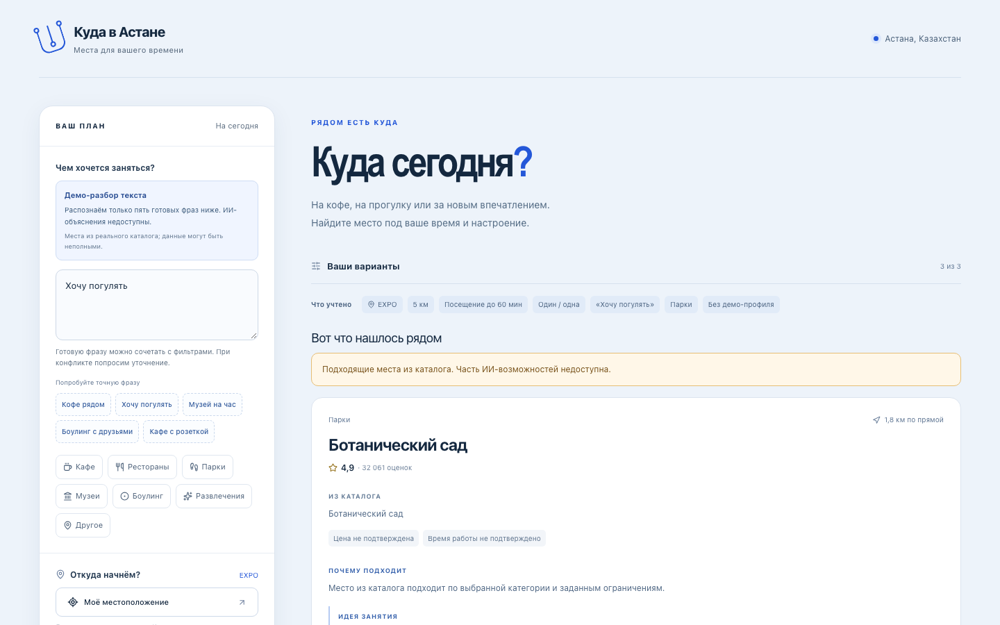
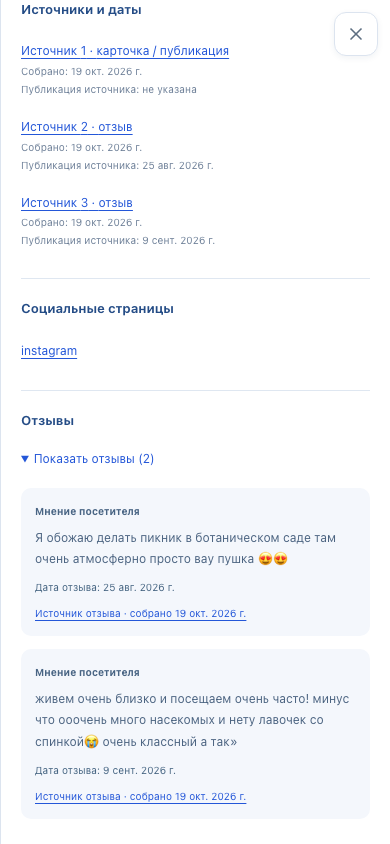

# Куда в Астане

**Место для прогулки, кофе или встречи — с понятным выбором и маршрутом.**

Адаптивный помощник по Астане: задайте локацию и ограничения, получите до трёх мест, посмотрите источники и продолжите путь в 2ГИС или Google Maps. Проект для AituHack · Build with AI.

[**Открыть демо →**](https://donate-cooperation-quick-annual.trycloudflare.com) · [Презентация, 7 слайдов](output/submission/aituhack-submit-now.pptx) · [Видео MP4, 1:50](output/submission/aituhack-demo.mp4) · [Пакет для сабмита](docs/submission/submit-now.md)

<!-- LIVE_STATUS:BEGIN -->
> **Живой ИИ и RAG подключены.** Mistral Small 3.2 через OpenRouter / DeepInfra разбирает свободный текст и объясняет выбор по источникам. Семантический поиск использует реальный сохранённый индекс.
>
> Два реальных smoke-теста прошли: запрос прогулки дал два подходящих парка; обязательная розетка — честный пустой результат. Это проверенная версия для демонстрации; полная проверка модели на 12 сценариях ещё не завершена.
<!-- LIVE_STATUS:END -->



*Исторический снимок принятой stub-версии: реальные места, явные ограничения и переход к маршруту. Скриншоты и видео не доказывают работу живой модели.*

## Что умеет приложение

| Возможность | Как это работает |
|---|---|
| Описать желание | Свободный текст → ИИ-разбор намерения и ограничений; объяснения с привязкой к источникам |
| Выбрать место | Категории, радиус поиска, время на посещение, компания и бюджет на человека |
| Получить 0–3 варианта | Только места из каталога, прошедшие строгие фильтры; без подходящих мест — честный пустой результат |
| Понять рекомендацию | Каталожные факты, отдельная идея занятия и отзывы как мнения с источниками |
| Посмотреть подробности | Рейтинг, координаты, известные часы, короткие выдержки и ссылки на карточки мест |
| Построить маршрут | «Пешком» или «На машине» → 2ГИС / Google Maps; начало пути выбирается в картах |
| Учесть предпочтения | Три явно обозначенных демо-профиля; текущий запрос важнее профиля |
| Вернуться к выбору | Сохранённые места и отметки «Не интересно» в браузере, без регистрации |
| Начать с удобной точки | EXPO, Бәйтерек, Набережная или геолокация только по нажатию пользователя |

<details>
<summary><strong>Мобильный экран: подробности и источники</strong></summary>



*Исторический снимок той же stub-версии при ширине 390 px.*

</details>

## Попробовать за минуту

1. Откройте [демо](https://donate-cooperation-quick-annual.trycloudflare.com).
2. Выберите **EXPO → 5 км → 60 мин**, бюджет оставьте пустым. Введите **«Найдите парк для часовой прогулки»**.
3. Нажмите **«Найти места»**: в проверенном live-сценарии появились **Ботанический сад** и **Президенттік саябақ**. Число результатов — от нуля до трёх, в зависимости от условий.
4. Откройте **«Подробности»**, посмотрите источники и выберите маршрут.

**Пустой бюджет и 0 — разные условия.** Пустое поле снимает денежный лимит. Ноль требует подтверждённо бесплатного посещения; в текущем каталоге цены неизвестны, поэтому результат будет пустым.

## Как устроен RAG

В live-конвейере модель работает с отобранными местами, а каталог определяет факты:

1. **Разобрать запрос.** Строгая JSON-схема выделяет намерение и ограничения. Конфликт или потеря обязательного условия приводят к уточнению.
2. **Применить фильтры.** Сервер проверяет радиус, время, бюджет и подтверждённые свойства. Неизвестное значение не превращается в подходящее.
3. **Найти кандидатов.** Сохранённые эмбеддинги, семантическое сходство, текстовые сигналы и предпочтения помогают упорядочить подходящие места. В объяснение передаются не более восьми кандидатов.
4. **Проверить объяснение.** Модель возвращает структурированный ответ; сервер проверяет ID и источники. Названия, рейтинг, координаты, URL и часы берутся из POI. Ответ дополнительно проходит проверки схемы, принадлежности мест каталогу, ссылок на источники и ограничений. Впечатления из отзывов явно помечены как мнения.

Реальный индекс **298 × 1536** принят локально. На фиксированных 12 RU-сценариях: **12/12 попаданий в top-3**, macro Recall@5 **97,22%**, micro **93,75%**; четыре отрицательных сценария и строгие фильтры прошли проверки. Это development set, созданный по источникам, а не независимый слепой бенчмарк. Результат retrieval не заменяет проверку качества ответов LLM.

[Контракт данных и API](docs/data-contract.md) · [Индекс и метрики](docs/indexing.md) · [Разметка RU](docs/evaluation-labels.md) · [Отдельные 4 KK-примера](docs/evaluation-kk.md)

## Данные

**298 реальных мест · 7 категорий · 591 короткая выдержка с источниками.**

Источник — сохранённый пользовательский снимок 2ГИС через Apify от 19 октября 2026: 298 мест и 1953 отзыва. Локальный адаптер очистил данные и выбрал до двух коротких буквальных выдержек на место; повторного сбора не было. Приложение использует `data/catalog/places.json`, а raw/normalized остаются локальными.

Отзывы — мнения, а не подтверждённые свойства. Неизвестные цены, часы и amenities сохраняются неизвестными. Ссылки отзывов ведут на карточки филиалов; право на публичную публикацию исходных текстов отдельно не установлено.

[Происхождение и импорт](docs/collection-import.md) · [Ограничения версии](docs/submission/limitations.md)

## Технологии

| Слой | Стек |
|---|---|
| Интерфейс | Next.js 16.4.2, React 19.3.1, TypeScript, Tailwind CSS, shadcn/ui |
| Проверка данных | Zod, строгие API-схемы и проверка источников |
| Поиск | Файловый POI-каталог, сохранённые эмбеддинги и детерминированные фильтры |
| ИИ | Mistral Small 3.2 / DeepInfra через серверный OpenRouter; embeddings — OpenAI text-embedding-3-small через тот же шлюз; учёт расходов |
| Проверки | Vitest, Playwright, production tracing и offline retrieval eval |

## Запустить локально

Нужны **Node.js 24.21.0** и **pnpm 11.0.8** — версии зафиксированы в проекте.

```sh
pnpm install --frozen-lockfile
APP_AI_MODE=stub OPENROUTER_PAID_ENABLED=false LIVE_EVAL_ENABLED=false pnpm dev
```

Откройте `http://localhost:3000`. Без ключа доступны категории и пять демо-фраз; неизвестный текст просит уточнение. По умолчанию текстовый режим `disabled`, поэтому для демонстрации явно задаётся `APP_AI_MODE=stub`.

Ключ OpenRouter хранится только на сервере. Наличие ключа или смена режима сами по себе не разрешают платные вызовы; правила запуска и контроля расходов — в [budget.md](docs/budget.md). Raw, ledger, кеши и реальные `.env` не публикуются.

## Проверки

Offline-проверки не требуют реальных вызовов модели:

```sh
export OPENROUTER_PAID_ENABLED=false LIVE_EVAL_ENABLED=false
pnpm lint
pnpm typecheck
pnpm test
pnpm build
pnpm check:build-artifacts
pnpm test:e2e
pnpm eval:retrieval
python3 scripts/check_harness.py
```

Проверено: **1051 unit-тест** backend-кандидата, затем **4 отдельных render-теста** исправления подписей отзывов; lint, typecheck, production build и проверка состава сборки. Два live-сценария прошли в браузере на 390 × 844 и 1440 × 900; источники, строгие ограничения и ссылки карт проверены. Финальная публичная сборка отвечает HTTP 200; её 9 статических ресурсов совпадают с принятой сборкой. Проверка известных ключей в исходниках и сборке: **0 утечек**. Полный live-eval на 12 сценариях не завершён.

## Материалы и границы

- [Актуальная презентация — PPTX, 7 слайдов](output/submission/aituhack-submit-now.pptx).
- [MP4 — 110 секунд, H.264, без звука](output/submission/aituhack-demo.mp4): копия сохранённой записи stub-версии. В ролике указан прежний URL; для показа используйте ссылку на демо в начале README.
- [Описание для формы и сценарий показа](docs/submission/submit-now.md).
- [Готовность](docs/readiness-report.md) · [Статус задач](tracker.yaml) · [Передача](docs/handoff.md).

Временный публичный адрес зависит от работающих Mac, сервера, туннеля и сети; постоянного hosting/SLA нет. Текущий URL не подтверждён физическим телефоном; прежнюю stub-сборку с обеими нативными картами пользователь проверял. Голос не реализован. Приёмка живой модели на всех 12 сценариях не завершена; отдельные smoke-тесты её не заменяют. YouTube-загрузка и официальная отправка заявки не выполнены.
