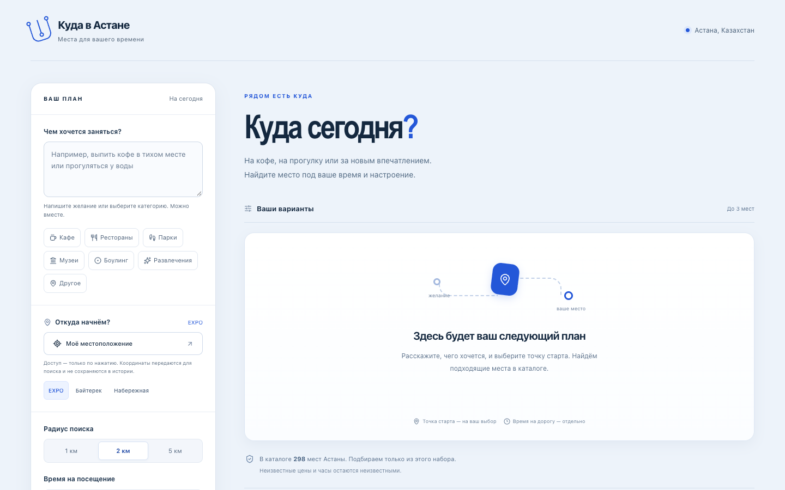
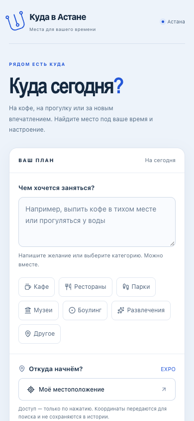

# UI/UX audit and redesign

Current screenshots were captured and opened before implementation. The previous running live build was preserved in a separate checkout. Product Design audit + frontend-design guided the work; no third-party source code or assets were copied.

## Observed before redesign

1. Start and describe — usable, but desktop devotes a tall column to controls and a large panel to repeated idle instructions. Mobile consumes the first viewport before radius/time and the submit action.
2. Check conditions — all categories, company, geolocation explanations and demo profile controls compete at once. Labels are present; the density makes the next action harder to find.
3. Results and route — factual unknowns, opinions and map links are available, but repeated descriptions and equal-weight secondary actions lengthen each card.
4. Accessibility limits — screenshots establish spacing and visual hierarchy only. Keyboard, focus, source identity, strict constraints and route destinations were separately exercised in browser tests.

## Accepted direction

Paper #f5f1e7, ink #282b23, olive #536144, terracotta #9a4934; system Georgia Cyrillic headings and readable system sans. Reference principles: [Cereal City Guides](https://www.studiofaculty.com/work/cereal-city-guides) for margin, book-like typography and consistently placed metadata; [The Modern House Journal](https://themodernhouse.com/journal) for editorial hierarchy and quiet dividers. Actual reference screenshots inspected in IAB20October2026. User expressly rejected white/violet; no cold accent retained.

The main path is describe → review a visible condition summary → receive places → route. Conditions, profile/history, activity/save and alternate map options are disclosures. Unknown values/opinion labels remain visible and strict filters remain intact. Measured key text contrast pairs range5.35–12.75:1; this is not a claim of complete WCAG conformance.

## Verification

See the current checkpoint in [progress](progress.md) and [tracker](../tracker.yaml). Browser tests cover keyboard disclosures, full condition summaries, zero-budget recovery/focus, sources/opinions, both map modes, stale responses and preferences. Root additionally inspected production360px: initial submission did not reveal results, so the executor added a failing360px regression and explicit-submit-only focus/scroll correction before final acceptance. No automatic preference-refresh jump is intended. New real-AI media is accepted separately from offline/stub UI verification.

## Final content reduction

Latest user direction asks for minimal content. Removed extra hero/footer slogans, duplicate success heading/message, and inactive summary defaults; core and every active condition remain visible. Data/warnings/version are behind one clear disclosure, while card unknown values, opinions, degraded and empty/error guidance remain visible. Scoped independent review and70offline browser scenarios passed; root current1055unit suite and final production build passed.
